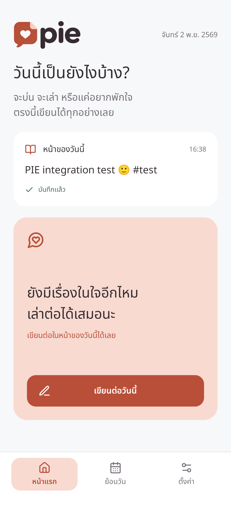
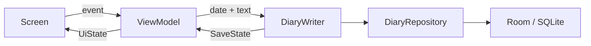

<p align="center">
  
</p>

<h1 align="center">PIE</h1>

<p align="center">
  <strong>ไดอารี่เล็ก ๆ ที่อยู่กับเราในทุกวัน</strong><br />
  จะเล่า จะบ่น หรืออยากระบาย — เปิดมาแล้วเริ่มเขียนได้เลย
</p>

<p align="center">
  <strong>Android 8.0+</strong> · Kotlin + Compose · Local First
</p>

<p align="center">
  <a href="downloads/PIE-v0.4.1-debug.apk"><strong>⬇ ดาวน์โหลด APK ทดลอง · v0.4.1</strong></a>
  &nbsp; · &nbsp;
  <a href="#getting-started">เริ่มพัฒนา</a>
  &nbsp; · &nbsp;
  <a href="docs/ROADMAP.md">Roadmap</a>
</p>

---

PIE เป็นแอปไดอารี่ส่วนตัวสำหรับ Android แต่ละวันมีกระดาษหนึ่งหน้า กลับมาเขียนต่อได้กี่รอบก็ได้ รองรับข้อความ Emoji และ `#` แบบข้อความธรรมดา ข้อมูลหลักอยู่บนเครื่องและเริ่มใช้งานได้โดยไม่ต้องสร้างบัญชี

**สถานะ: UI Preview `0.4.1`** — ปรับตามแบบ Pen R2 พร้อม PIE loader และ motion ใหม่ ปุ่มสปริง แถบเมนูเลื่อน การ์ดไล่จังหวะ และการเปลี่ยนเดือน พร้อมแนบรูป/วิดีโอ, PIN, แจ้งเตือน และ Backup/Restore เข้ารหัส งานวัดการใช้งานในเครื่องและการตรวจรับ V1 บนอุปกรณ์หลายรุ่นยังอยู่ในแผน

## สิ่งที่ทำได้ตอนนี้

| ประสบการณ์ | พฤติกรรมที่มีแล้ว |
|---|---|
| เปิดมาเล่าเรื่อง | คำชวนเล่า/กำลังใจหมุนเวียน 240 ประโยคตามวัน และตัวอย่างบันทึกวันนี้ |
| หนึ่งวัน หนึ่งหน้า | เขียนต่อวันเดิมได้หลายรอบ และเปิดวันย้อนหลังได้ |
| เขียนตามใจ | ข้อความ Emoji และ `#` โดยไม่ต้องตั้งหัวข้อ |
| บันทึกอัตโนมัติ | แสดงกำลังบันทึก / บันทึกแล้ว / ล้มเหลว พร้อมลองใหม่ |
| ย้อนวัน | ปฏิทินเลือกวัน จุดแสดงวันที่มีบันทึก และข้อความตัวอย่าง |
| ข้อมูลในเครื่อง | Room / SQLite ไม่ต้อง Login และไม่มี INTERNET permission |
| จังหวะการใช้งาน | Pen R2, Noto Sans Thai, Lucide, spring feedback, sliding tabs และ staged entrances · [Motion](docs/MOTION.md) |
| สื่อของวันนี้ | เลือกจากเครื่อง เก็บสำเนา เปิดดูรูป/วิดีโอ และลบหลังยืนยัน |
| PIN ส่วนตัว | ตั้ง/เปลี่ยน/ปิด PIN 6 หลัก ล็อกเมื่อออกจากแอป และจำกัดการลองผิด |
| แจ้งเตือน | 240 ประโยคฮีลใจ/ชวนเล่า หรือข้อความที่ตั้งเอง เลือกวัน/หลายเวลา พร้อมขอสิทธิ์และทดสอบ · [คลังข้อความ](docs/DAILY_MESSAGES.md) |
| ไฟล์สำรอง | Export เข้ารหัส แสดงเวลาส่งออกสำเร็จล่าสุด และมีเมนูนำเข้าตลอด · Restore เมื่อแอปว่าง · [รายละเอียด](docs/BACKUP_UX_V0_4_1.md) |

[ดูวิดีโอ motion v0.3.0 จากแอปจริง](docs/assets/motion-v0.3.mp4) · [ดู PIE loader v0.3.1](docs/assets/loader-v0.3.1.gif)

**[เปิดไฟล์ออกแบบ PIE-v0.4.pen](design/PIE-v0.4.pen)** · [วิธีเปิดและรายการไฟล์รูปประกอบ](design/README.md) — เก็บต้นฉบับ R2 พร้อมโลโก้และรูปที่อ้างอิงไว้ใน repo แล้ว

<p align="center">
  
  <br />
  <sub>ภาพจากแอปที่รันจริงบน Android emulator · รุ่น UI Preview</sub>
</p>

<a id="download"></a>

## ดาวน์โหลดและติดตั้ง

**[ดาวน์โหลด PIE v0.4.1 — Debug APK](downloads/PIE-v0.4.1-debug.apk)**

| รายการ | รายละเอียด |
|---|---|
| ชื่อไฟล์ | `PIE-v0.4.1-debug.apk` |
| เวอร์ชัน / Build | `0.4.1` / `7` |
| Android ขั้นต่ำ | Android 8.0 · API 26 |
| ขนาดไฟล์ | 17,739,872 bytes · ประมาณ 17.7 MB |
| Package | `com.ntdpz.pie` |
| การเซ็น | Android debug key ของเครื่องที่ build |
| ตรวจความถูกต้อง | [SHA256SUMS](downloads/SHA256SUMS) |

ไฟล์ APK อยู่ใน repo โดยตรง เมื่อเปิดลิงก์บน GitHub ให้เลือก **Download raw file** หาก GitHub แสดงหน้ารายละเอียดไฟล์ การใช้งานลิงก์ผ่าน GitHub ต้องมีการ push README และโฟลเดอร์ `downloads/` ขึ้นไปแล้ว

1. ดาวน์โหลด APK ลงโทรศัพท์ Android
2. เปิดไฟล์ และอนุญาตการติดตั้งจากแอปที่ใช้เปิดไฟล์เมื่อ Android ขอ
3. ติดตั้ง แล้วเปิด **PIE**

หรือใช้ Android SDK Platform Tools จากเครื่องพัฒนา:

```powershell
adb devices
adb install -r downloads/PIE-v0.4.1-debug.apk
```

ถ้ามีหลายอุปกรณ์ ให้เลือก serial จาก `adb devices` แล้วใส่ `-s SERIAL` ก่อน `install`

**ขอบเขตของรุ่นทดลอง:** มี PIN และไฟล์สำรองเข้ารหัสแล้ว แต่ยังอยู่ในช่วงทดสอบ UI/อุปกรณ์ ฐานข้อมูลในเครื่องยังไม่ได้เข้ารหัสระดับแอป หากถอนหรือล้างข้อมูล ต้องมีไฟล์สำรองและรหัสผ่านของตนเองจึงนำกลับมาได้ การอัปเดตทับต้องใช้ package และ signing key ที่เข้ากัน

### ตรวจ SHA-256

```powershell
Get-FileHash downloads/PIE-v0.4.1-debug.apk -Algorithm SHA256
Get-Content downloads/SHA256SUMS
```

ค่า SHA-256 ของไฟล์ใน repo ชุดนี้:

```text
ab0a3416ec19e4ac1caf1ceb4a29d9347ecc5565f941de4868b6fff1e43da277
```

## สารบัญสำหรับนักพัฒนา

- [Tech stack](#tech-stack)
- [สิ่งที่ต้องเตรียม](#prerequisites)
- [เริ่มพัฒนา](#getting-started)
- [โครงสร้างและหน้าที่](#architecture)
- [ข้อมูลและ Auto Save](#data-and-autosave)
- [Configuration](#configuration)
- [คำสั่งที่ใช้ประจำ](#commands)
- [การทดสอบและ CI](#testing)
- [Build และการส่งมอบ APK](#distribution)
- [แก้ปัญหาที่พบบ่อย](#troubleshooting)
- [แนวทางพัฒนาต่อ](#contributing)
- [เอกสารและ Roadmap](#documentation)

<a id="tech-stack"></a>

## Tech stack

| ส่วน | เทคโนโลยีที่ใช้อยู่ |
|---|---|
| ภาษา | Kotlin `2.2.10` · AGP built-in Kotlin สำหรับ Android modules |
| UI | Jetpack Compose · Material 3 · Compose BOM `2026.09.00` |
| Animation | Compose Animation |
| State / Lifecycle | ViewModel · immutable UiState · StateFlow |
| งาน asynchronous | Kotlin Coroutines `1.10.2` |
| Navigation | Navigation Compose `2.9.5` |
| ฐานข้อมูล | Room `2.8.5` / SQLite · schema 2 พร้อม migration 1→2 · KSP `2.3.13` |
| การตั้งค่า | DataStore Preferences `1.1.7` |
| สื่อ | Coil `3.3.0` + Media3 `1.8.0` |
| Backup | ZIP + PBKDF2 + AES-256-GCM |
| Dependency injection | Manual constructor injection ผ่าน `AppContainer` |
| Build | Gradle `9.4.1` · Android Gradle Plugin `9.2.1` |
| Android | minSdk `26` · compileSdk `37` · targetSdk `37` |
| Quality checks | JUnit · Coroutines Test · Compose UI Test · Android Lint |
| CI | GitHub Actions สำหรับ build, unit tests, lint และตรวจขอบเขตโมดูล |

เวอร์ชันอ้างอิงจาก [Version Catalog](gradle/libs.versions.toml) การเพิ่ม dependency ต้องมีงานใช้งานจริงรองรับ DataStore, Coil และ Media3 ใช้งานแล้ว ส่วน Google Drive SDK ยังไม่ถูกเพิ่ม

<a id="prerequisites"></a>

## สิ่งที่ต้องเตรียม

- **Android Studio** รุ่นที่รองรับ AGP 9.2.1
- **JDK 17 ขึ้นไป** — ชุดตรวจสอบและ CI ใช้ JDK 21
- **Android SDK Platform 37** และ **Build Tools 36.0.0**
- **Android SDK Platform Tools** สำหรับ `adb`
- **Git** และ **PowerShell 7 / pwsh** สำหรับสคริปต์ตรวจ architecture
- โทรศัพท์หรือ emulator **API 26 ขึ้นไป** สำหรับรันแอป

ติดตั้ง SDK ผ่าน SDK Manager หรือใช้คำสั่งนี้เมื่อมี `sdkmanager` อยู่ใน PATH:

```powershell
sdkmanager "platforms;android-37" "build-tools;36.0.0" "platform-tools"
sdkmanager --licenses
```

Gradle Wrapper อยู่ใน repo แล้ว ไม่ต้องติดตั้ง Gradle แยก และไม่ต้องมี backend, API key หรือบัญชี Google สำหรับรันรุ่นนี้

<a id="getting-started"></a>

## เริ่มพัฒนา

### 1. เปิดโปรเจกต์

ถ้ามี checkout อยู่แล้ว ให้เปิดโฟลเดอร์ `PIE` ใน Android Studio และ Sync Gradle

สำหรับการ clone หลังจาก source ถูก push ขึ้น GitHub:

```powershell
git clone https://github.com/Ntdpz/PIE.git
Set-Location PIE
```

### 2. กำหนด Java และ SDK

ตั้ง **Gradle JDK** ใน Android Studio เป็น JDK 21 หรือกำหนด `JAVA_HOME` สำหรับการ build ผ่าน terminal

Android Studio สามารถสร้าง `local.properties` ให้ได้ ตัวอย่างไฟล์บน Windows:

```properties
sdk.dir=C\:/Users/YOUR_USER/AppData/Local/Android/Sdk
```

เปลี่ยนเป็น SDK path ของเครื่องตัวเอง เครื่องหมาย `:` ของ drive ต้อง escape ในไฟล์ properties และ `local.properties` ถูก ignore จาก Git

```powershell
java -version
.\gradlew.bat --version
```

### 3. Build และรัน

```powershell
.\gradlew.bat :app:assembleDebug
```

APK จะอยู่ที่ `app/build/outputs/apk/debug/app-debug.apk`

เปิด emulator หรือเสียบเครื่องที่เปิด USB debugging:

```powershell
adb devices
.\gradlew.bat :app:installDebug
adb shell am start -n com.ntdpz.pie/.MainActivity
```

บน macOS / Linux ใช้ `./gradlew` แทน `.\gradlew.bat` หากจำเป็นให้เปิดสิทธิ์รันด้วย `chmod +x gradlew`

### 4. ลองเส้นทางหลัก

เปิด PIE → เริ่มเขียนวันนี้ → พิมพ์ข้อความ → รอ “บันทึกแล้ว” → กลับหน้าแรก → เปิดย้อนวัน → เลือกวันที่และเปิดบันทึก

Room สร้างฐานข้อมูลเมื่อเริ่มใช้งานเอง ไม่มีขั้นตอนสร้าง database server หรือ seed ข้อมูลก่อนรัน

<a id="architecture"></a>

## โครงสร้างและหน้าที่

**เขียนเหมือนสายพาน: input ชัด → ทำหน้าที่เดียว → output ชัด**

```text
PIE/
├── app/                     จุดเริ่มแอป, ประกอบ dependency และ navigation
├── core/
│   ├── domain/              โมเดล สัญญา repository และคิวเขียน · Kotlin ล้วน
│   ├── data/                Room, SQL, entity และการแปลงข้อมูล
│   └── designsystem/        Theme, Logo, Component และ Motion
├── feature/
│   ├── home/                คำชวนเขียนและตัวอย่างบันทึกวันนี้
│   ├── editor/              โหลดข้อความ รับการแก้ไข และแสดงสถานะบันทึก
│   ├── history/             ปฏิทิน วันเลือก และข้อความตัวอย่าง
│   └── settings/            หน้าตั้งค่าขั้นต้น
├── docs/                    Architecture, สเปก, Roadmap และผลตรวจสอบ
│   └── assets/              ภาพประกอบ README
├── downloads/               APK ทดลองพร้อม SHA-256
├── gradle/                  Version Catalog และ Gradle Wrapper
├── scripts/                 ตรวจขอบเขต architecture
└── .github/workflows/       CI
```

| ส่วน | รับผิดชอบ | ขอบเขต |
|---|---|---|
| Screen | วาด state และส่ง callback | ไม่ทำ IO และไม่ถือ navigation controller |
| Route | เชื่อม ViewModel กับ Screen | collect state ตาม lifecycle |
| ViewModel | รับ event และแปลงเป็น UiState | ไม่รับ Android Context หรือ DAO |
| DiaryWriter | เรียงคิวบันทึกและติดตาม revision | ไม่ตัดสินใจเรื่องหน้าจอ |
| Repository | สัญญาอ่านและเขียนข้อมูล | UI ไม่รู้จัก implementation |
| Room / DAO | จัดเก็บและ query | entity และ SQL อยู่ใน data |
| AppContainer | สร้าง instance และกำหนด lifetime | ประกอบ dependency จากจุดเดียว |

ฟีเจอร์ไม่อ้างถึงกัน และไม่อ้าง `core:data` โดยตรง ใช้ contract จาก `core:domain` ส่วน `app` เชื่อมเส้นทางทั้งหมด



ดู dependency graph และกติกาเพิ่มเติมใน [Architecture](docs/ARCHITECTURE.md) และ [AGENTS.md](AGENTS.md)

<a id="data-and-autosave"></a>

## ข้อมูลและ Auto Save

### ฐานข้อมูล

ไฟล์ฐานข้อมูลชื่อ `pie.db` อยู่ในพื้นที่ส่วนตัวของแอป มีตารางหลัก `diary_entries`:

| คอลัมน์ | หน้าที่ |
|---|---|
| `date` | Primary key รูปแบบ ISO date เช่น `2026-11-02` |
| `text` | ข้อความของวันนั้น |
| `updatedAtEpochMillis` | เวลาที่รับการแก้ไขเป็น epoch milliseconds |

หนึ่งวันที่มี primary key เดียวจึงถูก upsert เป็นหน้าเดิม ปฏิทินอ่านเฉพาะวันที่ เวลา และ preview สูงสุด 160 ตัวอักษรจาก SQL แทนการโหลดเนื้อหาทั้งหมดของทุกวัน

Schema เวอร์ชัน 1 และ 2 เก็บที่ [core/data/schemas](core/data/schemas) การแก้ schema ต้องเพิ่ม migration และทดสอบ ห้ามใช้ destructive migration กับข้อมูลผู้ใช้

### ลำดับ Auto Save

1. Screen ส่งข้อความเข้า ViewModel และ UI แสดงข้อความใหม่ทันที
2. ViewModel ส่งข้อความพร้อม **วันที่ของหน้าที่เปิด** เข้า DiaryWriter
3. Writer กำหนด revision และแสดง `Saving`
4. Worker ตัวเดียวบันทึกผ่าน repository ตามลำดับ
5. เปลี่ยนเป็น `Saved` หลังฐานข้อมูลตอบสำเร็จ และเฉพาะเมื่อยังเป็น revision ล่าสุด
6. ถ้าล้มเหลว แสดง `Failed` และเก็บ draft ในหน่วยความจำเพื่อให้ลองใหม่

Writer มีอายุเท่ากับ process ของแอป การออกจากหน้าเขียนจึงไม่ยกเลิกงานที่รับไว้แล้ว วันที่ของหน้าจะคงเดิมแม้เขียนข้ามเที่ยงคืน

ข้อความที่ยังไม่แสดง “บันทึกแล้ว” อาจหายเมื่อ process ถูกปิดหรือเครื่องดับ ส่วน draft ที่เก็บในหน่วยความจำไม่ใช่ Backup

### ความเป็นส่วนตัวของรุ่นปัจจุบัน

- ไม่มี Login, INTERNET permission หรือการส่ง analytics
- ปิด Android automatic backup และกำหนด extraction rules สำหรับ cloud backup / device transfer
- ข้อความหลักเก็บในฐานข้อมูลบนเครื่อง
- PIN เก็บเฉพาะ hash/salt และล็อกเมื่อออกจากแอป ส่วนฐานข้อมูลในเครื่องยังไม่เข้ารหัสระดับแอป
- นำเข้าจากไฟล์สำรองของตนเองพร้อมรหัสผ่านได้เมื่อแอปยังว่าง ไม่มีระบบกู้ PIN หรือรหัสผ่านไฟล์สำรอง

ข้อกำหนดปลายทางของ V1 ดูที่ [Product V1](docs/PRODUCT_V1.md)

<a id="configuration"></a>

## Configuration

| ค่า / ไฟล์ | ใช้ทำอะไร | การเก็บ |
|---|---|---|
| `JAVA_HOME` | เลือก JDK สำหรับ terminal build | ตั้งในเครื่องพัฒนา |
| `ANDROID_HOME` | SDK path ทาง environment เมื่อไม่ได้ใช้ local.properties | ตั้งในเครื่องพัฒนา |
| `ANDROID_SERIAL` | เลือกอุปกรณ์สำหรับคำสั่ง Android เมื่อมีหลายเครื่อง | เลือกใช้ตามงาน |
| `local.properties` | `sdk.dir` เฉพาะเครื่อง | ไม่เข้า Git |
| `gradle.properties` | JVM memory, caching, parallel build, AndroidX | เข้า Git |
| `gradle/libs.versions.toml` | เวอร์ชัน plugin และ library | เข้า Git |
| `app/build.gradle.kts` | App ID, SDK, version และ build types | เข้า Git |

ไม่ต้องสร้าง `.env` หรือกำหนด cloud credentials สำหรับรุ่น Foundation ห้ามเพิ่ม signing key, PIN, รหัส Backup หรือข้อมูลไดอารี่จริงลง repo

<a id="commands"></a>

## คำสั่งที่ใช้ประจำ

รันจากโฟลเดอร์ root ของ repo:

| คำสั่ง PowerShell | ผลลัพธ์ |
|---|---|
| `.\gradlew.bat :app:assembleDebug` | สร้าง APK ทดลองที่เซ็นด้วย debug key |
| `.\gradlew.bat :app:installDebug` | ติดตั้ง Debug บนอุปกรณ์ที่ต่ออยู่ |
| `.\gradlew.bat :app:assembleRelease` | สร้าง Release APK ที่ยังไม่เซ็น |
| `.\gradlew.bat :core:domain:test` | ทดสอบ write pipeline แบบ JVM |
| `.\gradlew.bat testDebugUnitTest` | ทดสอบ unit tests ใน Android modules ที่มี test |
| `.\gradlew.bat lintDebug` | ตรวจ Android lint |
| `pwsh -File scripts/Verify-Architecture.ps1` | ตรวจ project dependency และ import ข้ามขอบเขต |
| `.\gradlew.bat :app:connectedDebugAndroidTest` | ทดสอบ UI บน Android |
| `.\gradlew.bat :core:data:connectedDebugAndroidTest` | ทดสอบการเก็บข้อมูล Room บน Android |
| `adb devices` | ดูอุปกรณ์สำหรับติดตั้งและทดสอบ |

<a id="testing"></a>

## การทดสอบและ CI

### ตรวจโดยไม่ต้องมี emulator

```powershell
pwsh -File scripts/Verify-Architecture.ps1
.\gradlew.bat :core:domain:test testDebugUnitTest lintDebug :app:assembleDebug
```

### ตรวจบน Android

เปิด emulator หรือเชื่อมโทรศัพท์ก่อน:

```powershell
adb devices
.\gradlew.bat :app:connectedDebugAndroidTest :core:data:connectedDebugAndroidTest
```

### ชุดทดสอบปัจจุบัน

| ชุด | ตรวจอะไร | ผลที่บันทึกไว้ |
|---|---|---|
| `DiaryWriterTest` | ลำดับเขียน วันที่ failure/retry ล้างข้อความ และ delete/backup barrier | 7 ผ่าน |
| `BackupCipherTest` | เข้ารหัส/ถอดรหัส รหัสผิด และไฟล์ถูกแก้ไข | 3 ผ่าน |
| `ReminderMessagesTest` | 240 ประโยคไม่ซ้ำ รอบรายวัน ข้อความเอง fallback และขอบเขตวันที่ | 5 ผ่าน |
| `SettingsWriterTest` | ลำดับแก้ข้อความแจ้งเตือนและการเขียนต่อหลังออกจากหน้า | 2 ผ่าน |
| Android data tests | Persistence, migration 1→2, Backup round trip และสื่อหลังลบต้นฉบับ | 4 ผ่าน |
| Android UI tests | เขียน/ย้อนอ่าน/recreate, หน้าตาม Pen, PIN และ loader | 5 ผ่าน |

รอบ v0.4.1 ผ่าน 18 unit cases และตรวจ Android data/UI บน emulator รายละเอียดการแก้เมนูนำเข้าและประวัติส่งออกอยู่ใน [Backup UX verification](docs/BACKUP_UX_V0_4_1.md) ผลนี้เป็นการตรวจในเครื่อง ไม่ใช่การยืนยัน CI หรือทุกอุปกรณ์

### CI

[Android checks](.github/workflows/android.yml) ทำงานเมื่อ push, เปิด pull request หรือสั่งรันเอง โดยเตรียม JDK 21 / SDK 37 แล้วตรวจขอบเขตโมดูล รัน unit tests / lint และ build Debug APK

Workflow ปัจจุบันยังไม่รัน emulator tests ไม่สร้าง GitHub Release และไม่อัปโหลด APK ให้ดาวน์โหลดโดยอัตโนมัติ

<a id="distribution"></a>

## Build และการส่งมอบ APK

| แบบ | Path | การใช้งาน |
|---|---|---|
| Debug | `app/build/outputs/apk/debug/app-debug.apk` | ติดตั้งทดสอบ เซ็นด้วย debug key |
| Release | `app/build/outputs/apk/release/app-release-unsigned.apk` | เปิด R8/resource shrinking แต่ต้องเซ็นก่อนติดตั้งเผยแพร่ |
| ไฟล์ดาวน์โหลดใน repo | `downloads/PIE-v0.4.1-debug.apk` | สำเนา Debug ที่ตรวจแล้วสำหรับชุดนี้ |

Release UI Preview v0.2.0 ที่ตรวจไว้มีขนาด 3,044,651 bytes หรือประมาณ 3.0 MB **เป็นไฟล์ unsigned** ขนาดนี้ยังไม่รวมฟีเจอร์ V1 ที่เหลือ และไม่ใช่ผลวัด RAM หรือความลื่นบนโทรศัพท์จริง

### อัปเดตไฟล์ดาวน์โหลดหลัง build ใหม่

หลังรันทดสอบแล้ว ให้ใช้ชื่อไฟล์ให้ตรงกับเวอร์ชัน:

```powershell
Copy-Item app/build/outputs/apk/debug/app-debug.apk downloads/PIE-v0.4.1-debug.apk
$apkHash = (Get-FileHash downloads/PIE-v0.4.1-debug.apk -Algorithm SHA256).Hash.ToLowerInvariant()
Add-Content downloads/SHA256SUMS "$apkHash  PIE-v0.4.1-debug.apk" -Encoding utf8NoBOM
```

เมื่อเปลี่ยนเวอร์ชัน ให้อัปเดตชื่อไฟล์ ปุ่มดาวน์โหลด ขนาด และ checksum ใน README ด้วย การเซ็น Release ต้องเก็บ keystore นอก repo และใช้ signing key เดิมสำหรับการอัปเดตแอป

หากเริ่มออกหลายเวอร์ชัน ให้ย้าย APK ไปเป็น GitHub Release assets เพื่อไม่ให้ประวัติ Git โตตามไฟล์ binary แล้วเปลี่ยนปุ่มดาวน์โหลดหลังสร้าง Release และตรวจลิงก์จริงแล้ว

<a id="troubleshooting"></a>

## แก้ปัญหาที่พบบ่อย

| อาการ | ตรวจและแก้ |
|---|---|
| `SDK location not found` | ตั้ง SDK ใน Android Studio หรือสร้าง local.properties ให้ตรงเครื่อง |
| Lint แจ้ง `PropertyEscape` | ใช้ `C\:/...` ในค่า sdk.dir ของไฟล์ properties |
| หา Android API 37 ไม่เจอ | ติดตั้ง platforms;android-37 จาก SDK Manager |
| Java/Gradle เวอร์ชันไม่เข้ากัน | ตรวจ java -version, Gradle JDK และใช้ wrapper ของ repo |
| adb devices ไม่แสดงเครื่อง | เปิด emulator หรือ USB debugging และยืนยันการเชื่อมต่อบนโทรศัพท์ |
| `INSTALL_FAILED_UPDATE_INCOMPATIBLE` | ตรวจ signing key ของแอปเดิม ใช้ key เดิมสำหรับอัปเดต อย่าถอนแอปที่มีบันทึกสำคัญเพื่อแก้ปัญหา |
| ติดตั้ง Release APK ไม่ได้ | ตรวจว่าไฟล์ผ่านการเซ็นแล้ว; app-release-unsigned.apk ยังไม่พร้อมติดตั้ง |
| UI test แจ้ง `InputManager.getInstance` | ใช้ dependency ที่ repo pin ไว้ รวม Espresso 3.7.0 แล้ว Sync ใหม่ |
| ย้าย resource แล้ว build ยังเห็นไฟล์เก่า | ลอง task เดิมพร้อม --no-watch-fs; ถ้ายังไม่หายค่อย clean เฉพาะ module ที่เกี่ยวข้อง |
| เห็น “กำลังบันทึก…” หรือ “บันทึกไม่สำเร็จ” | ยังไม่ควรถือว่าข้อความลงดิสก์ครบ ลองบันทึกใหม่และตรวจพื้นที่ว่าง |

หากรายงานปัญหา ให้แนบรุ่น Android, app version, ขั้นตอนทำซ้ำ และสถานะบันทึก โดยไม่นำเนื้อหาไดอารี่จริงหรือข้อมูลลับมาใส่ log

<a id="contributing"></a>

## แนวทางพัฒนาต่อ

เริ่มอ่าน [AGENTS.md](AGENTS.md) ก่อนเปลี่ยนโครงสร้าง:

1. ให้แต่ละ feature เป็นเจ้าของ Screen, Route, UiState และ ViewModel ของตัวเอง
2. เพิ่ม rule/contract ใน domain เมื่อมีหน้าที่จริง ไม่เพิ่ม use case เพื่อส่งต่อเฉย ๆ
3. เก็บ SQL, entity และการทำ IO ใน data
4. ประกอบ dependency และ navigation ที่ app
5. ส่ง callback ข้ามขอบเขต ไม่ import feature อื่นเข้ามา
6. เพิ่ม test สำหรับความเสี่ยงข้อมูลหาย ลำดับการบันทึก การกู้จาก error และ migration
7. รัน architecture check, tests, lint และ build ที่เกี่ยวข้องก่อนส่งงาน

ไม่เพิ่ม BaseViewModel, BaseRepository หรือ Utils รวมทุกอย่าง แยกไฟล์ตามหน้าที่ที่อธิบายได้ และคงการ inject dependency ให้มองตามทางเดินงานได้ชัด

<a id="documentation"></a>

## เอกสารและ Roadmap

| เอกสาร | เนื้อหา |
|---|---|
| [Product V1](docs/PRODUCT_V1.md) | ขอบเขตที่ตกลงไว้ทั้งหมด |
| [Architecture](docs/ARCHITECTURE.md) | ทิศทาง dependency, lifetime และจุดต่อยอด |
| [Pen R2](docs/DESIGN_REFERENCE.md) | ภาพต้นแบบและ design tokens ที่ใช้ทำ UI |
| [Roadmap](docs/ROADMAP.md) | สถานะ Foundation และงานที่เหลือ |
| [Verification](docs/VERIFICATION.md) | สิ่งที่ทดสอบจริงและข้อจำกัด |
| [Engineering rules](AGENTS.md) | กติกาเขียนโค้ดแบบสายพาน |

ลำดับถัดไป: Local usage ในเครื่อง → ทดสอบอุปกรณ์/IME/Accessibility/พื้นที่เต็มและ process death → ตรวจรับและเซ็น Release

**V2:** Google Drive Sync / Backup และการย้ายเครื่อง โดยยังให้ฐานข้อมูลในเครื่องเป็นแหล่งข้อมูลหลัก

---

<p align="center">
  <strong>PIE</strong><br />
  <sub>เรื่องธรรมดาของทุกวัน ก็มีพื้นที่ให้เก็บไว้</sub>
</p>
