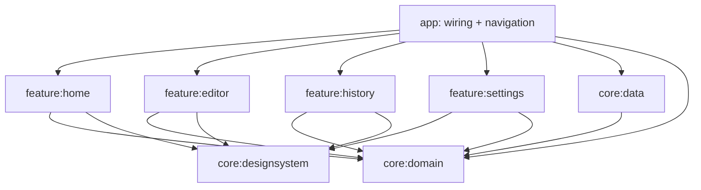

# Architecture

## หลักการ

แต่ละส่วนเหมือนสถานีในสายพาน: รับ input ที่ชัด ทำหน้าที่เดียว และส่ง output ที่ชัด ทำงานแยกกันได้และติดตามปัญหาย้อนกลับได้

เลือกแยกเป็น 8 Gradle modules เพื่อให้ compiler ช่วยป้องกันการผูกฟีเจอร์เข้าหากัน ไม่สร้าง module เปล่าสำหรับทุกฟีเจอร์ในอนาคต

## ทิศทาง dependency

ไม่มีลูกศรระหว่าง feature และไม่มีลูกศรจาก domain กลับไป Android หรือ Room ตรวจด้วย `scripts/Verify-Architecture.ps1` และ Gradle classpath ของแต่ละ module

## เจ้าของงาน

| สถานี | รับ | ทำ | ส่ง |
|---|---|---|---|
| Screen | immutable UiState + callbacks | วาดหน้าจอและรับ gesture | event/callback |
| Route | ViewModel + navigation callback | collect state ตาม lifecycle | state เข้า Screen |
| ViewModel | repository/writer/clock ที่จำเป็น | แปลง event เป็น UI state และเรียกงาน | StateFlow |
| DiaryWriter | date + text | เรียงคิวเขียนและติดตาม revision | SaveState รายวัน |
| DiaryRepository | domain models | สัญญาอ่าน/เขียนบันทึก | Flow / ผลอ่าน |
| RoomDiaryRepository | DAO | แปลง entity ↔ domain | domain models |
| DiaryDao | entity/key | SQL | entity |
| AppContainer | application context | สร้าง instance และกำหนด lifetime | dependency ที่ใช้ได้จริง |

## ทางเดินการบันทึก

1. `EditorScreen` ส่งข้อความไป `EditorViewModel.onTextChanged`
2. ViewModel อัปเดตข้อความใน state ทันที แล้วส่งวันที่ของหน้าที่เปิดให้ `DiaryWriter`
3. Writer กำหนด revision และแสดง Saving
4. worker ตัวเดียวเขียนตามลำดับผ่าน repository ไป Room
5. เมื่อฐานข้อมูลตอบสำเร็จ จึงเปลี่ยนเป็น Saved ถ้ายังเป็น revision ล่าสุด
6. ถ้าล้มเหลว แสดง Failed และเก็บ draft ในหน่วยความจำเพื่อให้ลองใหม่หรือกลับมาเปิดหน้าต่อได้

อายุ writer เท่ากับแอป ไม่เท่ากับหน้าจอ จึงไม่ยกเลิกงานที่รับไว้แล้วเมื่อกดย้อนกลับ อย่างไรก็ตาม draft ที่ยังไม่ Saved ยังเสี่ยงหายเมื่อ process ถูกปิดหรือเครื่องดับ การแสดงสถานะต้องไม่สัญญาเกินจริง

คิวเริ่มต้นเขียนทุก edit แบบเรียงลำดับ เพื่อให้ตรวจสอบและทดสอบง่าย หาก profiling พบปัญหาที่ข้อความยาวมาก ให้เปลี่ยนเป็น coalescing รายวันโดยเพิ่ม ordering / flush tests ก่อน ห้าม debounce ใน Composable หรือปล่อย coroutine เขียนแข่งกัน

ตั้งแต่ 0.2.0 คิวรับคำสั่ง Delete และ Barrier ด้วย การลบรอ write ที่รับไว้แล้วก่อน เพื่อไม่ให้ข้อความเก่ากลับมาหลังลบ ส่วน Backup รอ Barrier และไม่ส่งออกถ้ายังมี draft ที่บันทึกล้มเหลว

การตั้งค่าแจ้งเตือนมีคิวเขียนแยกใน SettingsViewModel ปิดคิวเมื่อออกจากหน้า แต่ให้ app scope ทำรายการที่รับไว้แล้วจนเสร็จ

## Persistence และไฟล์ใน 0.2.0

- Room schema 2 เพิ่ม diary_media และ migration 1 → 2 โดยคง diary_entries เดิม
- LocalMediaRepository คัดลอกผ่านไฟล์ staging แล้ว commit metadata และไฟล์เข้าด้วยกัน ไม่เก็บ URI ต้นฉบับเป็นแหล่งข้อมูลหลัก
- สื่อของแต่ละวันมี FK cascade เมื่อวันที่ถูกลบ และไฟล์ต้นฉบับภายนอกไม่ถูกแตะต้อง
- LocalSettingsRepository ใช้ DataStore; PIN เก็บเฉพาะ PBKDF2 hash/salt พร้อมจำกัดความถี่การลองผิด
- SessionViewModel/PieSessionGate ดูแล lifecycle lock และ FLAG_SECURE แยกจาก feature UI
- AndroidReminders/ReminderReceiver เป็น adapter สำหรับ notification, alarm, reboot และ timezone changes
- BackupManifestIO ดูแล schema archive; BackupCipher ดูแล PBKDF2 + AES-256-GCM; LocalBackupRepository ประกอบงานไฟล์และฐานข้อมูล
- Merge import decrypt/authenticate จบก่อนอ่าน ZIP ตรวจข้อมูลลง staging แล้วให้ตรวจรายการและเลือกข้อความรายวันก่อน commit; PIN ธีม และแจ้งเตือนคงค่าของเครื่องนี้ ดู [Merge v0.5.0](MERGE_IMPORT_V0_5_0.md)
- ฐานข้อมูลในเครื่องยังไม่มีการเข้ารหัสระดับแอป; PIN เป็น access gate ไม่ใช่ encryption

## ขอบเขตและ lifetime

- Screen: ไม่มี Context, DAO, file IO หรือ navigation controller
- ViewModel: ไม่มี Android Context และไม่เลือก implementation เอง
- Repository/database/writer: app scoped
- วันที่ของ editor: มาจาก navigation argument และคงเดิมข้ามเที่ยงคืน
- Home: refresh วันที่เมื่อกลับมา foreground
- Clock: inject ได้เพื่อทดสอบวันและเวลา

## กติกาช่วย maintain

- ไม่สร้าง BaseViewModel, BaseRepository หรือ Utils รวมทุกอย่าง
- ไม่บังคับหนึ่งฟังก์ชันต่อไฟล์ แยกเมื่อมีหน้าที่และเหตุผลชัด
- ใช้ use case เมื่อมี rule, orchestration หรือ reuse ไม่สร้างชั้นส่งต่อเฉย ๆ
- error ไม่เก็บเนื้อหาไดอารี่ลง log; cancellation ต้องส่งต่อ
- visual token/motion อยู่ designsystem; business rules อยู่ domain
- text ที่แสดงในโครงนี้เป็นภาษาไทยโดยตรง ก่อนรองรับหลายภาษาค่อยย้ายเข้า string resources พร้อมกันทั้งแอป

## จุดต่อยอด

| งาน | จุดเพิ่ม | สิ่งที่ต้องไม่เกิด |
|---|---|---|
| สื่อ | domain media contract + data file store | เก็บ video blob ใน Room หรืออ่านไฟล์บน main thread |
| PIN | session/lock policy แยกจาก UI | เก็บ PIN plaintext หรือถือว่า PIN เท่ากับ encryption |
| แจ้งเตือน | schedule contract + Android scheduler | schedule จาก Composable |
| Backup | archive reader/writer + encryption + restore validation | อ่านไฟล์ทั้งหมดเข้า RAM หรือทับข้อมูลก่อนตรวจเสร็จ |
| Drive Sync | sync worker + transport แยกจาก local source | ทำให้การเขียนวันนี้ต้องรอ network |

ก่อนเปลี่ยน schema ต้องมี migration ไม่ใช้ fallbackToDestructiveMigration ไม่มี Cloud SDK หรือ DI framework ในฐานนี้

## การตรวจ

- unit tests: ลำดับเขียน, ข้อความล่าสุด, แยกวันที่, failure/retry, ล้างข้อความ
- Android integration test: upsert วันเดิมและปิด/เปิดฐานข้อมูลใหม่
- lint + debug/release compilation
- architecture script: ตรวจ project dependency และ import ข้ามขอบเขต
- งานถัดไป: instrumentation กับ editor navigation, process lifecycle และ Thai IME
